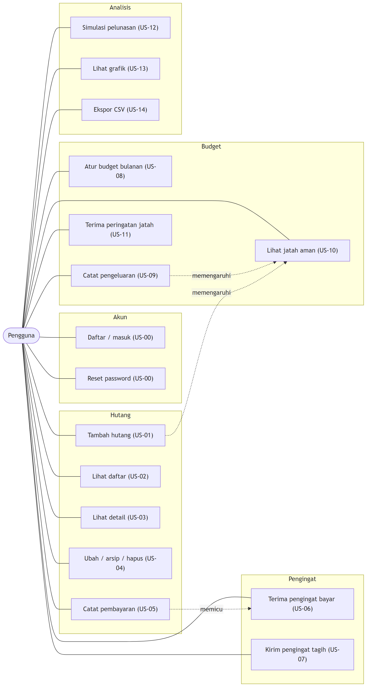
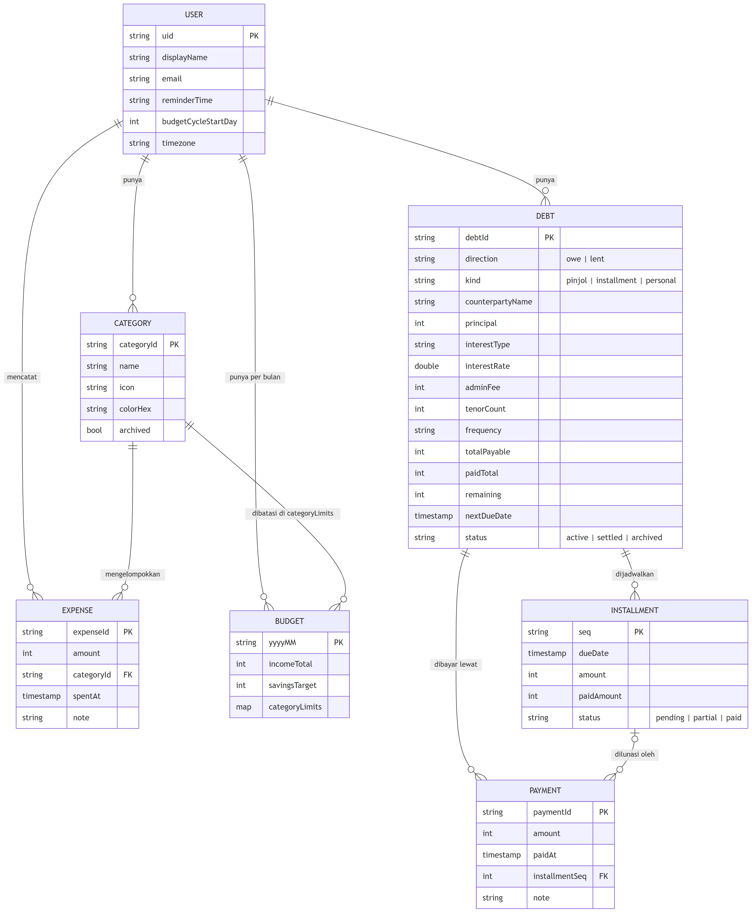
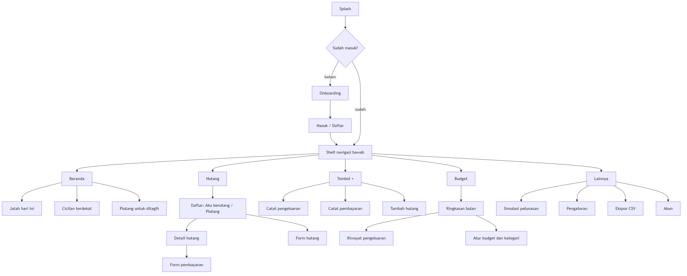
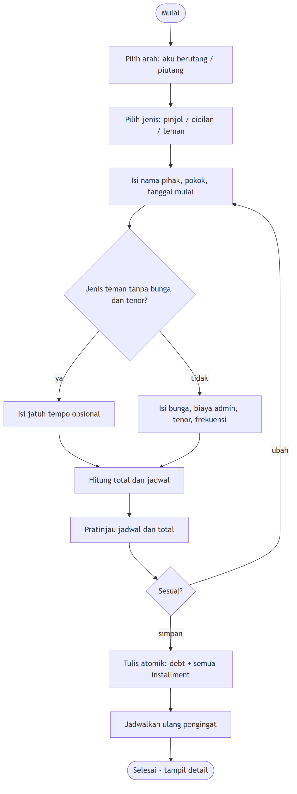
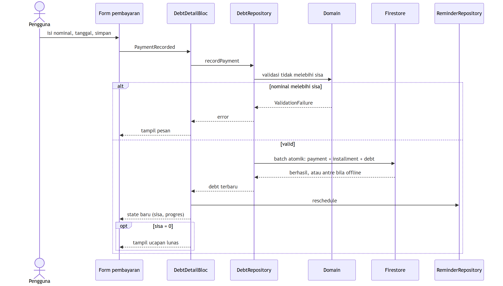
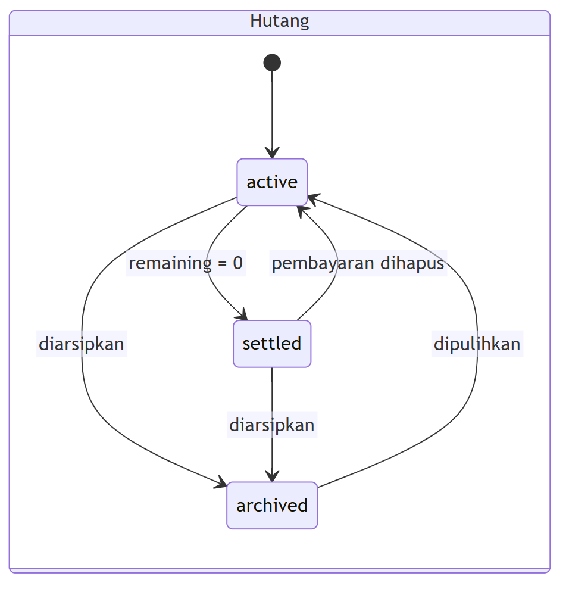
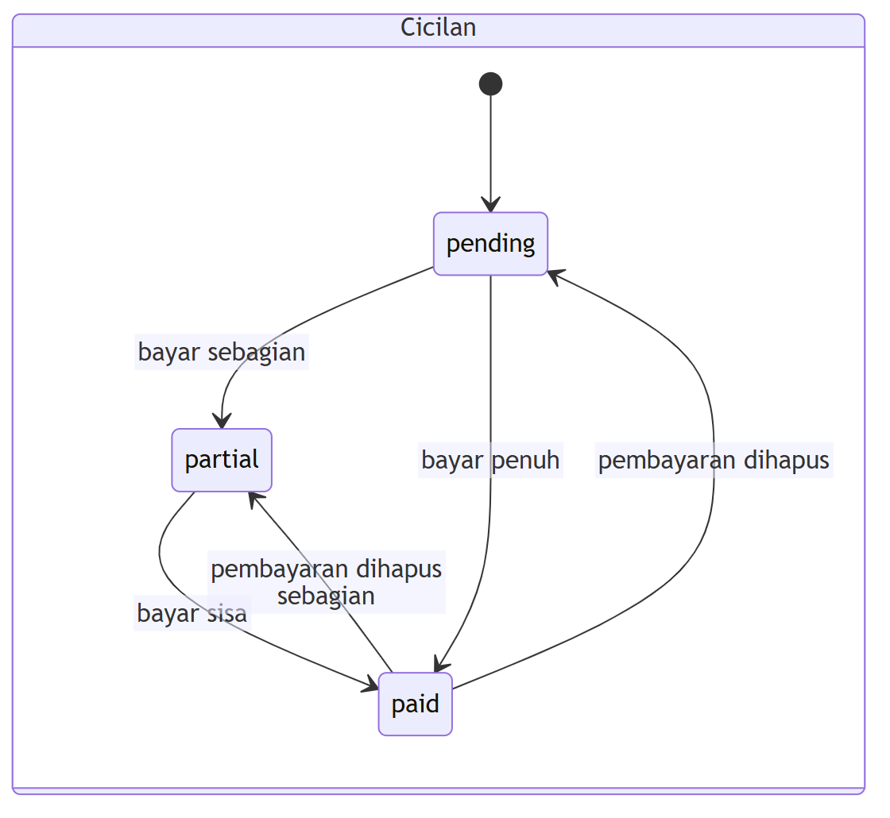
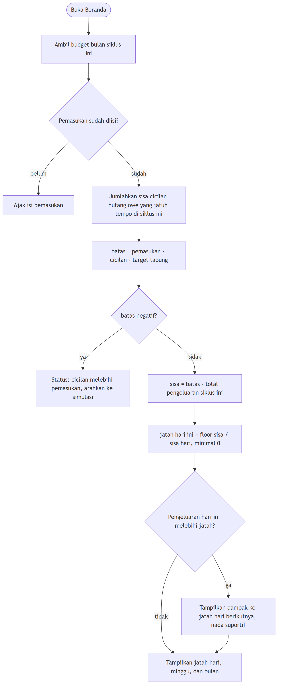

# DIAGRAMS — GeuraLunas

Versi 0.1 · 2026-11-09

Diagram disimpan sebagai gambar PNG (`docs/diagrams/*.png`) supaya tampil di semua penampil Markdown: GitHub, VS Code, Antigravity, dan Android Studio, tanpa ekstensi. Sumbernya berupa file [Mermaid](https://mermaid.js.org/) (`docs/diagrams/*.mmd`) dan merupakan sumber kebenaran.

**Mengubah diagram:** edit file `.mmd`, lalu jalankan `bash docs/diagrams/render.sh` (butuh Node.js dan Chrome) untuk membuat ulang PNG. Commit `.mmd` dan `.png` bersama. Jika skema atau alur berubah, perbarui juga dokumen terkait (`DATABASE.md`, `ARCHITECTURE.md`, `PRD.md`).

Daftar: 1 Use case · 2 ERD · 3 Arsitektur · 4 Sitemap · 5 Alur tambah hutang · 6 Sequence catat pembayaran · 7 Sequence pengingat · 8 State hutang dan cicilan · 9 Alur hitung jatah aman · 10 Alur simulasi

---

## 1. Use case

Satu aktor: Pengguna. Kode `US-xx` merujuk ke [PRD.md](PRD.md).

Sumber: [`01-use-case.mmd`](diagrams/01-use-case.mmd)

---

## 2. ERD (model data Firestore)

Firestore berbasis dokumen: relasi `USER → anak` berarti subkoleksi di bawah `users/{uid}`. Detail field di [DATABASE.md](DATABASE.md).

Sumber: [`02-erd.mmd`](diagrams/02-erd.mmd)

---

## 3. Arsitektur berlapis

Panah = "bergantung pada". Lapisan atas boleh memakai bawah, tidak sebaliknya. `domain` tidak bergantung pada apa pun. Detail di [ARCHITECTURE.md](ARCHITECTURE.md).

Sumber: [`03-arsitektur.mmd`](diagrams/03-arsitektur.mmd)

---

## 4. Sitemap navigasi

Sumber: [`04-sitemap.mmd`](diagrams/04-sitemap.mmd)

---

## 5. Alur tambah hutang (US-01)

Sumber: [`05-alur-tambah-hutang.mmd`](diagrams/05-alur-tambah-hutang.mmd)

---

## 6. Sequence — catat pembayaran (US-05)

Sumber: [`06-seq-catat-pembayaran.mmd`](diagrams/06-seq-catat-pembayaran.mmd)

---

## 7. Sequence — pengingat jatuh tempo (US-06)

Sumber: [`07-seq-pengingat.mmd`](diagrams/07-seq-pengingat.mmd)

---

## 8. State — hutang dan cicilan

Sumber: [`08a-state-hutang.mmd`](diagrams/08a-state-hutang.mmd)

Sumber: [`08b-state-cicilan.mmd`](diagrams/08b-state-cicilan.mmd)

"Terlambat" bukan state tersimpan: diturunkan dari `status = active` dan `nextDueDate` sebelum hari ini.

---

## 9. Alur hitung jatah aman (US-10, US-11)

Rumus lengkap di [DATABASE.md bagian 6](DATABASE.md).

Sumber: [`09-alur-jatah-aman.mmd`](diagrams/09-alur-jatah-aman.mmd)

---

## 10. Alur simulasi pelunasan (US-12)

Sumber: [`10-alur-simulasi.mmd`](diagrams/10-alur-simulasi.mmd)
