# DIAGRAMS — GeuraLunas

Versi 0.1 · 2026-11-09

Semua diagram memakai [Mermaid](https://mermaid.js.org/) dan tampil otomatis di GitHub dan VS Code (ekstensi Mermaid). Jika skema atau alur berubah, perbarui diagram di sini bersama dokumen terkait (`DATABASE.md`, `ARCHITECTURE.md`, `PRD.md`).

Daftar: 1 Use case · 2 ERD · 3 Arsitektur · 4 Sitemap · 5 Alur tambah hutang · 6 Sequence catat pembayaran · 7 Sequence pengingat · 8 State hutang dan cicilan · 9 Alur hitung jatah aman · 10 Alur simulasi

---

## 1. Use case

Satu aktor: Pengguna. Kode `US-xx` merujuk ke [PRD.md](PRD.md).

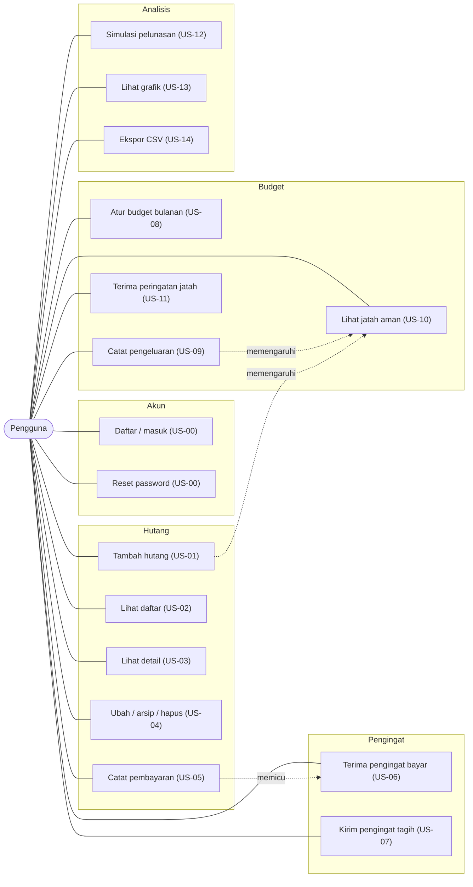

---

## 2. ERD (model data Firestore)

Firestore berbasis dokumen: relasi `USER → anak` berarti subkoleksi di bawah `users/{uid}`. Detail field di [DATABASE.md](DATABASE.md).

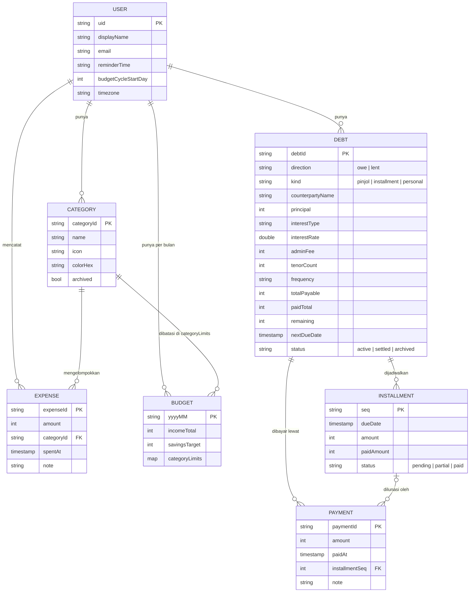

---

## 3. Arsitektur berlapis

Panah = "bergantung pada". Lapisan atas boleh memakai bawah, tidak sebaliknya. `domain` tidak bergantung pada apa pun. Detail di [ARCHITECTURE.md](ARCHITECTURE.md).

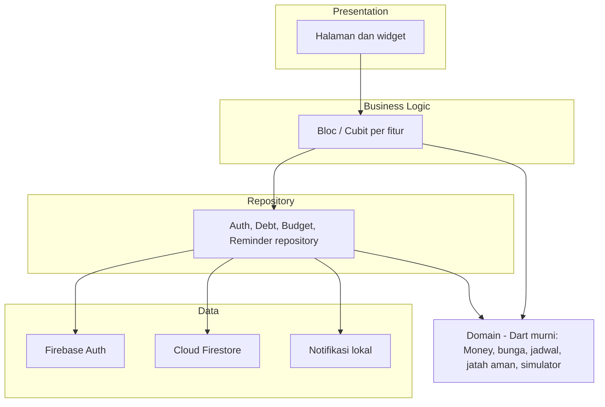

---

## 4. Sitemap navigasi

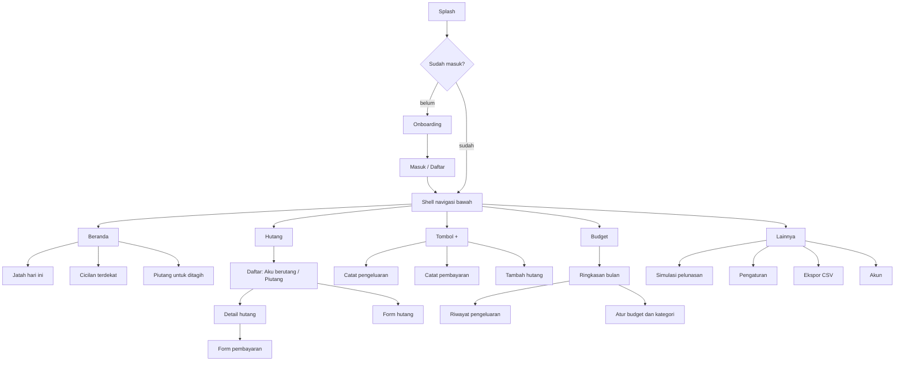

---

## 5. Alur tambah hutang (US-01)

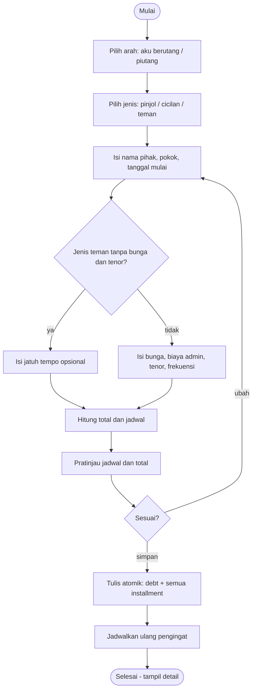

---

## 6. Sequence — catat pembayaran (US-05)

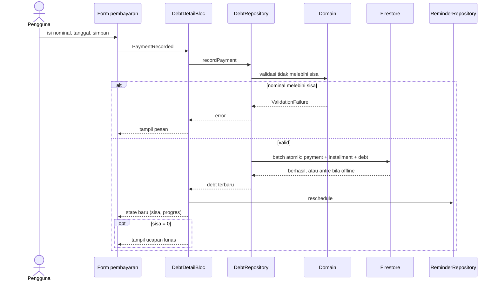

---

## 7. Sequence — pengingat jatuh tempo (US-06)

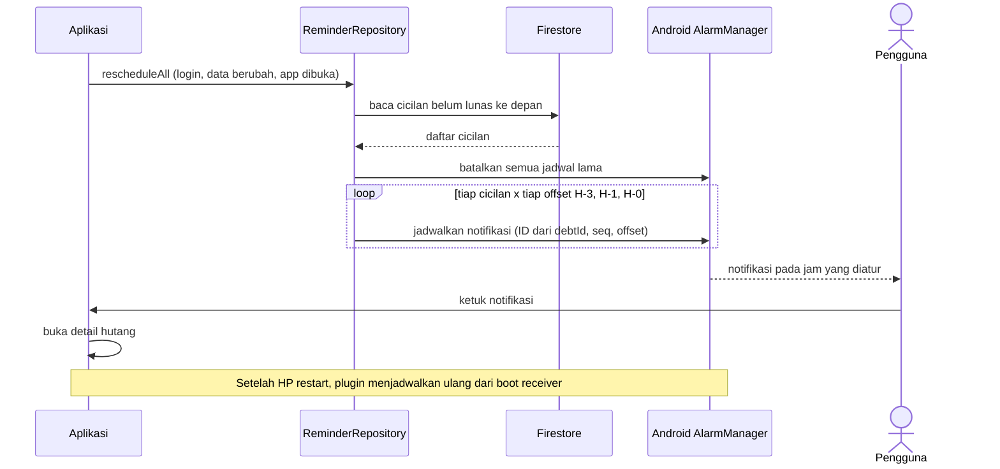

---

## 8. State — hutang dan cicilan

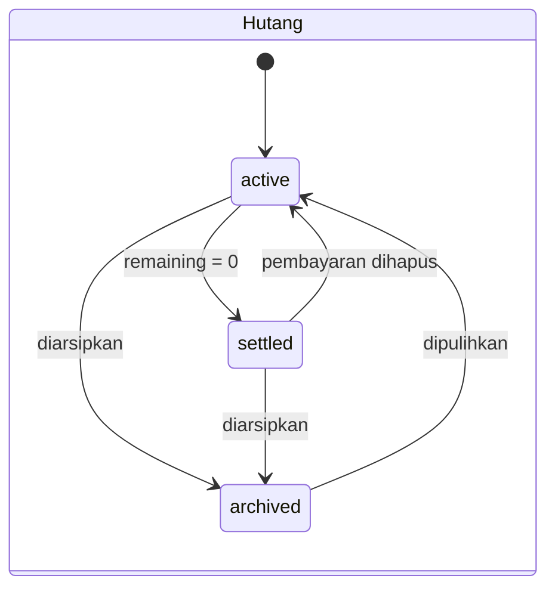

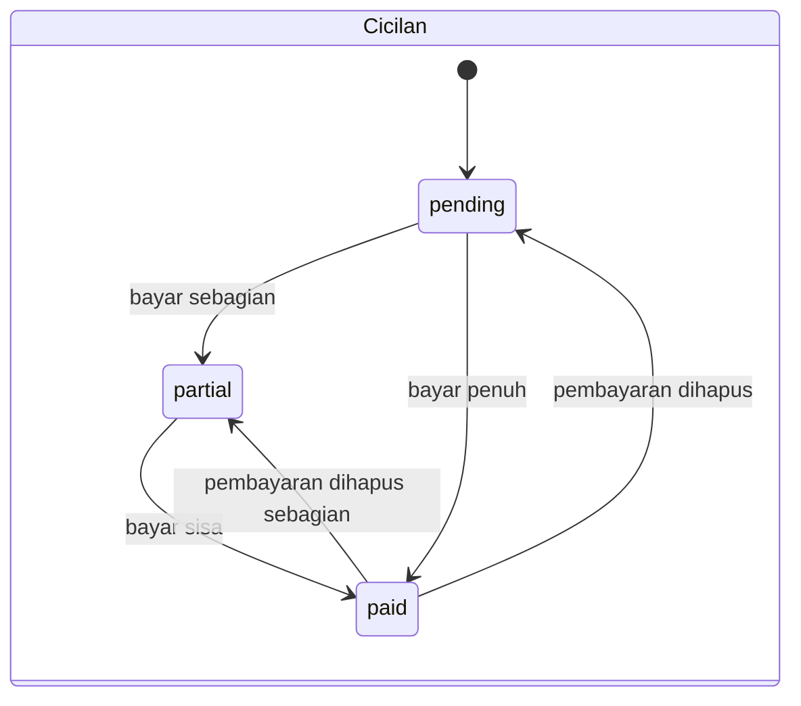

"Terlambat" bukan state tersimpan: diturunkan dari `status = active` dan `nextDueDate` sebelum hari ini.

---

## 9. Alur hitung jatah aman (US-10, US-11)

Rumus lengkap di [DATABASE.md bagian 6](DATABASE.md).

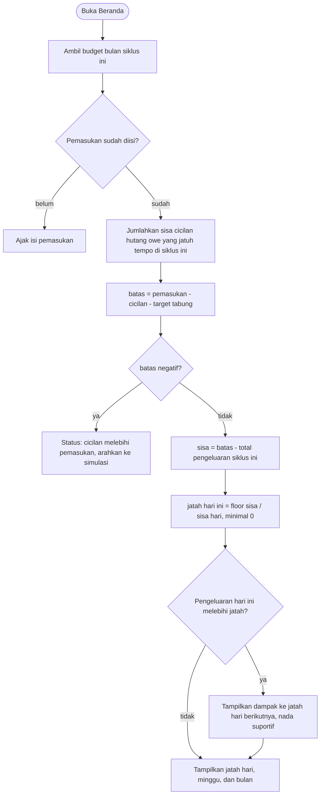

---

## 10. Alur simulasi pelunasan (US-12)

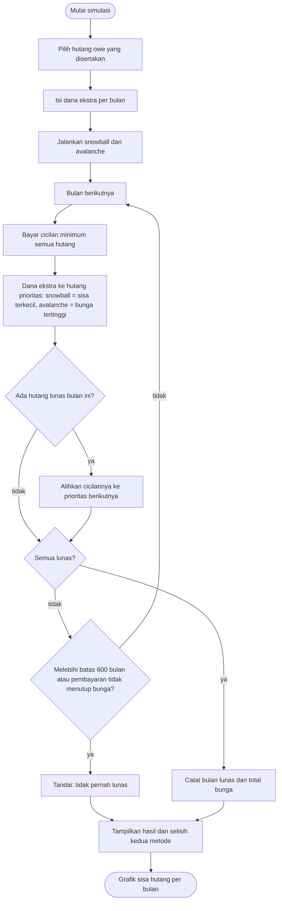
